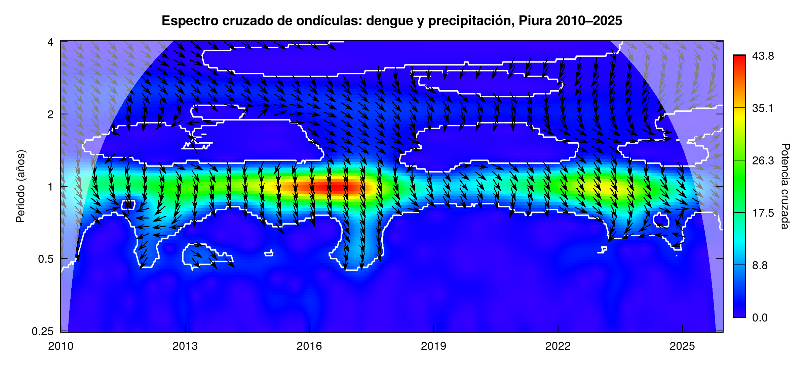
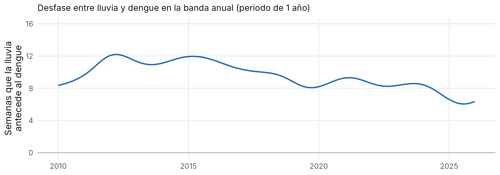

```{r}
#| label: datos
if (.Platform$OS.type == "windows") {
  invisible(Sys.setlocale("LC_CTYPE", ".UTF-8"))
}

library(readr)
library(dplyr)
library(tidyr)
library(ggplot2)

dir_datos <- if (dir.exists("datos")) "datos" else file.path("..", "..", "datos")

dengue <- read_csv(file.path(dir_datos, "procesados", "dengue_piura_semanal.csv"),
                   col_types = cols(ubigeo = col_character()), show_col_types = FALSE)
cortes <- read_csv(file.path(dir_datos, "procesados", "dengue_piura_2023_cortes.csv"),
                   show_col_types = FALSE)

# Serie semanal 2010-2025 con ceros explícitos (semanas 1-52)
serie <- dengue |>
  filter(ano <= 2025, semana <= 52) |>
  group_by(ano, semana) |>
  summarise(casos = sum(casos), .groups = "drop") |>
  complete(ano = 2010:2025, semana = 1:52, fill = list(casos = 0)) |>
  arrange(ano, semana) |>
  mutate(t = (ano - 2010) * 52 + semana,
         fecha = as.Date(paste0(ano, "-01-01")) + (semana - 1) * 7)

s2023 <- filter(serie, ano == 2023)

anos_base <- setdiff(2016:2022, 2017)   # siete años previos sin 2017

canal_cuartiles <- serie |>
  filter(ano %in% anos_base) |>
  group_by(semana) |>
  summarise(q1 = quantile(casos, 0.25), q2 = median(casos),
            q3 = quantile(casos, 0.75), .groups = "drop")

canal_geom <- serie |>
  filter(ano %in% anos_base) |>
  group_by(semana) |>
  summarise(m = mean(log(casos + 1)), de = sd(log(casos + 1)), .groups = "drop") |>
  mutate(centro = exp(m) - 1,
         inf = pmax(exp(m - 1.96 * de) - 1, 0),
         sup = exp(m + 1.96 * de) - 1)

# Regresión estacional tipo Serfling (cuasi-Poisson)
entren <- filter(serie, ano %in% setdiff(2015:2022, 2017))
modelo <- glm(casos ~ t + sin(2 * pi * semana / 52) + cos(2 * pi * semana / 52),
              family = quasipoisson, data = entren)
phi <- summary(modelo)$dispersion
serf <- s2023 |>
  mutate(esperado = predict(modelo, newdata = s2023, type = "response"),
         limite = qnbinom(0.975, mu = esperado, size = esperado / (phi - 1)))

# Descomposición de la serie: log(casos + 1), equivalente a un modelo multiplicativo
serie_ts <- ts(log(serie$casos + 1), start = c(2010, 1), frequency = 52)
desc_clasica <- decompose(serie_ts, type = "additive")
desc_stl <- stl(serie_ts, s.window = 13, robust = TRUE)

panel_descomp <- function(tendencia, estacional, residuo, titulo) {
  niveles <- c("Casos (escala log)", "Tendencia (casos)", "Factor estacional", "Residuo (factor)")
  base <- tibble(fecha = serie$fecha, casos = serie$casos,
                 tendencia = exp(as.numeric(tendencia)) - 1,
                 estacional = exp(as.numeric(estacional)),
                 residuo = exp(as.numeric(residuo)))
  largo <- bind_rows(
    transmute(base, fecha, panel = niveles[1], valor = casos + 1),
    transmute(base, fecha, panel = niveles[2], valor = tendencia),
    transmute(base, fecha, panel = niveles[3], valor = estacional),
    transmute(base, fecha, panel = niveles[4], valor = residuo)
  ) |>
    mutate(panel = factor(panel, levels = niveles))
  ggplot(largo, aes(fecha, valor)) +
    geom_line(data = ~ filter(.x, panel != niveles[4]), linewidth = 0.5) +
    geom_segment(data = ~ filter(.x, panel == niveles[4]),
                 aes(xend = fecha, y = 1, yend = valor), linewidth = 0.3, colour = "grey30") +
    geom_hline(data = tibble(panel = factor(niveles[3:4], levels = niveles), y = 1),
               aes(yintercept = y), colour = "grey60") +
    facet_grid(panel ~ ., scales = "free_y", switch = "y") +
    scale_y_continuous(trans = "log10", labels = scales::label_number(accuracy = 0.1, big.mark = " ", drop0trailing = TRUE)) +
    labs(x = NULL, y = NULL, title = titulo) +
    theme_minimal(base_size = 15) +
    theme(strip.placement = "outside", strip.text.y.left = element_text(angle = 0, hjust = 1, size = 14),
          panel.grid.minor = element_blank(), plot.title = element_text(size = 15),
          panel.spacing.y = unit(0.6, "lines"))
}

# Triángulo de notificación: casos por semana de inicio y retraso (semanas)
triangulo <- read_csv(file.path(dir_datos, "procesados", "dengue_piura_2023_triangulo.csv"),
                      show_col_types = FALSE)

# Nowcast bayesiano simple al cierre de la SE 20
nowcast_simple <- function(triangulo, corte, D = 8, ventana = 8, S = 4000, semilla = 2023) {
  set.seed(semilla)
  obs <- filter(triangulo, semana_inicio + retraso_semanas <= corte)
  # Retrasos de las semanas ya completas (todas las celdas observadas)
  semanas_completas <- (corte - D - ventana + 1):(corte - D)
  n_d <- obs |>
    filter(semana_inicio %in% semanas_completas) |>
    group_by(retraso_semanas) |>
    summarise(n = sum(casos), .groups = "drop") |>
    complete(retraso_semanas = 0:D, fill = list(n = 0)) |>
    arrange(retraso_semanas) |>
    pull(n)
  # Posterior Dirichlet(1 + n_d) de la distribución de retrasos
  g <- matrix(rgamma(S * (D + 1), shape = 1 + n_d), nrow = S, byrow = TRUE)
  F_acum <- t(apply(g / rowSums(g), 1, cumsum))
  bind_rows(lapply((corte - D + 1):corte, function(t) {
    n_obs <- sum(obs$casos[obs$semana_inicio == t])
    F_t <- F_acum[, corte - t + 1]
    # Con previa plana para N: N - n_obs | n_obs ~ BinNeg(n_obs + 1, F_t)
    N <- n_obs + rnbinom(S, size = n_obs + 1, prob = F_t)
    tibble(semana = t, conocidos = n_obs, mediana = median(N),
           inf = quantile(N, 0.025), sup = quantile(N, 0.975))
  }))
}
nc20 <- nowcast_simple(triangulo, corte = 20)
consolidado <- triangulo |> group_by(semana = semana_inicio) |> summarise(consolidado = sum(casos))

tema <- theme_minimal(base_size = 18) +
  theme(panel.grid.minor = element_blank(),
        plot.caption = element_text(size = 11, colour = "grey40"))
fuente <- "Fuente: NotiSP, casos confirmados y probables de dengue por semana de inicio de síntomas, Piura."
col23 <- "#b2182b"
```

## Dónde quedamos

- **S1:** en la SE 10 de 2023, Piura tenía 473 casos frente a una mediana de 18,5. Discutimos si eso justificaba una alerta.
- **S2:** revisamos la base: unidad de observación, ceros, semanas incompletas y uniones con población.
- **Hoy:** ¿qué es lo esperado para una semana?, ¿desde cuándo había señal? y ¿cuánto confiamos en la última semana?

En el taller se presenta el **Avance 1**.

# La serie de Piura

## Dieciséis años de dengue en Piura

```{r}
#| label: serie-completa
#| fig-width: 12
#| fig-height: 5
ggplot(serie, aes(fecha, casos)) +
  geom_line(colour = "grey30", linewidth = 0.6) +
  annotate("text", x = as.Date(c("2015-05-01", "2017-05-01", "2023-05-01", "2024-05-01")),
           y = c(2600, 6200, 8600, 3200), label = c("2015", "2017", "2023", "2024"),
           colour = col23, size = 5) +
  scale_y_continuous(labels = scales::label_number(big.mark = " ")) +
  labs(x = NULL, y = "Casos por semana", caption = fuente) +
  tema
```

Años con pocos casos (2018–2020) alternan con epidemias grandes. ¿Qué es entonces un año «normal»?

## Tres componentes de una serie

:::: {.columns}
::: {.column width="45%"}
- **Tendencia:** cambio de nivel a lo largo de los años.
- **Estacionalidad:** patrón que se repite cada año (en la costa norte, el verano y otoño).
- **Componente irregular:** lo que queda; incluye los brotes.

Detectar una señal es decidir si lo que vemos excede lo que la tendencia y la estacionalidad permitirían esperar.
:::
::: {.column width="55%"}
```{r}
#| label: perfil-estacional
#| fig-width: 7
#| fig-height: 5.5
serie |>
  filter(ano %in% 2010:2022) |>
  group_by(ano) |>
  mutate(prop = casos / sum(casos)) |>
  group_by(semana) |>
  summarise(mediana = median(prop, na.rm = TRUE), .groups = "drop") |>
  ggplot(aes(semana, mediana)) +
  geom_col(fill = "#4f7fa8") +
  scale_y_continuous(labels = scales::label_percent()) +
  labs(x = "Semana epidemiológica", y = "Mediana del % anual",
       title = "Perfil estacional, 2010–2022") +
  tema + theme(plot.title = element_text(size = 16))
```
:::
::::

## Descomposición clásica de la serie de Piura

```{r}
#| label: descomp-clasica
#| fig-width: 13
#| fig-height: 6.2
panel_descomp(desc_clasica$trend, desc_clasica$seasonal, desc_clasica$random,
              "Descomposición multiplicativa clásica (medias móviles de 52 semanas)")
```

::: {.notes}
La tendencia sube en 2015–2017 y 2022–2024. En las semanas de mayor transmisión, el factor estacional multiplica los casos por más de 4. Los residuos grandes señalan los brotes. La descomposición clásica pierde 26 semanas al inicio y al final por la media móvil.
:::

## STL: una descomposición robusta a los brotes

```{r}
#| label: descomp-stl
#| fig-width: 13
#| fig-height: 6.2
panel_descomp(desc_stl$time.series[, "trend"], desc_stl$time.series[, "seasonal"],
              desc_stl$time.series[, "remainder"],
              "STL robusta (Loess, ventana estacional de 13 años)")
```

::: {.notes}
STL estima cada componente con regresión local y da menos peso a las semanas atípicas, así que los brotes quedan en el residuo y no deforman la estacionalidad. Las semanas con residuo alto son candidatas a señal. Ambas descomposiciones se hacen sobre log(casos + 1), lo que equivale a casos = tendencia × estacionalidad × residuo. Funciones de R base: decompose() y stl().
:::

## La escala cambia lo que vemos

```{r}
#| label: serie-log
#| fig-width: 12
#| fig-height: 4.8
ggplot(serie, aes(fecha, casos + 1)) +
  geom_line(colour = "grey30", linewidth = 0.6) +
  scale_y_log10(labels = scales::label_number(big.mark = " ")) +
  labs(x = NULL, y = "Casos + 1 (escala logarítmica)", caption = fuente) +
  tema
```

En escala logarítmica se ve el inicio de cada epidemia y los años bajos dejan de parecer planos. **¿Cuál le mostraría a un director regional?**

# Comparar con el pasado

## ¿Qué es «lo esperado»? {.smaller}

Toda línea basal depende de decisiones que hay que declarar:

| Decisión | Opciones | Efecto |
|---|---|---|
| Años de referencia | 5 a 7 años previos | Más años: más estable, pero menos actual |
| Años epidémicos | Incluir o excluir (por ejemplo, 2017) | Incluirlos sube el umbral y retrasa la alerta |
| Medida central | Mediana, media, media geométrica | La media se deja arrastrar por los picos |
| Límite superior | Q3, media + 2 DE, percentil 95 de un modelo | Define cuántas falsas alarmas se aceptan |
| Unidad | Casos o tasas | Las tasas corrigen cambios de población |

## Incluir o no 2017 cambia el umbral

```{r}
#| label: umbral-2017
#| fig-width: 12
#| fig-height: 4.6
q3_ref <- function(anos, etiqueta) {
  serie |>
    filter(ano %in% anos) |>
    group_by(semana) |>
    summarise(valor = quantile(casos, 0.75), .groups = "drop") |>
    mutate(serie = etiqueta)
}
bind_rows(
  q3_ref(2016:2022, "Q3 con 2017"),
  q3_ref(setdiff(2016:2022, 2017), "Q3 sin 2017"),
  q3_ref(2018:2022, "Q3 solo 2018–2022"),
  s2023 |> transmute(semana, valor = casos, serie = "2023")
) |>
  filter(semana <= 20) |>
  ggplot(aes(semana, valor + 1, colour = serie, linewidth = serie == "2023")) +
  geom_line() +
  scale_colour_manual(values = c("2023" = col23, "Q3 con 2017" = "#2166ac",
                                 "Q3 sin 2017" = "#67a9cf", "Q3 solo 2018–2022" = "grey50")) +
  scale_linewidth_manual(values = c(`TRUE` = 1.4, `FALSE` = 0.9), guide = "none") +
  scale_y_log10(labels = scales::label_number(big.mark = " ")) +
  labs(x = "Semana epidemiológica", y = "Casos + 1 (escala log)", colour = NULL) +
  tema + theme(legend.position = "top")
```

En la SE 10, el Q3 es 356 con 2017, 214 sin 2017 y 21 con solo 2018–2022. La elección de los años decide qué tan pronto aparece la alerta.

## Canal endémico por cuartiles

```{r}
#| label: canal-cuartiles
#| fig-width: 12
#| fig-height: 4.6
s2023 |>
  filter(semana <= 14) |>
  left_join(canal_cuartiles, by = "semana") |>
  ggplot(aes(semana)) +
  geom_ribbon(aes(ymin = 0, ymax = q1), fill = "#d9f0d3") +
  geom_ribbon(aes(ymin = q1, ymax = q2), fill = "#fff7bc") +
  geom_ribbon(aes(ymin = q2, ymax = q3), fill = "#fdd0a2") +
  geom_line(aes(y = casos), colour = col23, linewidth = 1.2) +
  scale_x_continuous(breaks = 1:14) +
  labs(x = "Semana epidemiológica", y = "Casos",
       subtitle = "Zonas: éxito (Q1), seguridad (Q2), alarma (Q3); encima de Q3, epidemia. Referencia: 2016–2022 sin 2017",
       caption = "Método según Bortman (1999).") +
  tema + theme(plot.subtitle = element_text(size = 13))
```

Con esta referencia, 2023 está en zona epidémica **desde la SE 1** [@bortman1999].

## Mismos años, otro método: media geométrica ± 1,96 DE

```{r}
#| label: canal-geom
#| fig-width: 12
#| fig-height: 4.6
s2023 |>
  filter(semana <= 26) |>
  left_join(canal_geom, by = "semana") |>
  ggplot(aes(semana)) +
  geom_ribbon(aes(ymin = inf, ymax = sup), fill = "grey85") +
  geom_line(aes(y = centro), colour = "grey40", linetype = "dashed") +
  geom_line(aes(y = casos), colour = col23, linewidth = 1.2) +
  scale_y_log10(labels = scales::label_number(big.mark = " ")) +
  labs(x = "Semana epidemiológica", y = "Casos (escala log)",
       subtitle = "Banda: media geométrica ± 1,96 DE de log(casos + 1), 2016–2022 sin 2017") +
  tema + theme(plot.subtitle = element_text(size = 13))
```

Con este método, 2023 recién supera el límite en la **SE 20**, la semana del pico.

## El mismo dato, cuatro respuestas {.smaller}

| Método | Referencia | Primera semana de 2023 con señal |
|---|---|---|
| Canal por cuartiles (Q3) | 2016–2022 sin 2017 | SE 1 |
| Regresión estacional cuasi-Poisson (límite 97,5 %) | 2015–2022 sin 2017 | SE 1 |
| Farrington flexible (paquete `surveillance`) | 5 años previos | SE 6 |
| Media geométrica ± 1,96 DE | 2016–2022 sin 2017 | SE 20 |

**¿Por qué tanta diferencia?** La media geométrica usa la variabilidad entre años, y en Piura esa variabilidad es enorme (años casi sin casos y años con miles). Con una banda tan ancha, casi nada la supera.

::: {.notes}
Cálculos hechos con la base del curso; el código está en la práctica. Insistir en que ningún método es «el correcto»: cada uno responde a cuántas falsas alarmas estamos dispuestos a aceptar. Notar también que 2023 empezó alto: 2022 cerró con 30 a 50 casos semanales, cuando lo habitual en esas semanas era menos.
:::

# Modelos para lo esperado

## Regresión estacional

```{r}
#| label: serfling
#| fig-width: 12
#| fig-height: 4.3
serf |>
  filter(semana <= 26) |>
  ggplot(aes(semana)) +
  geom_ribbon(aes(ymin = 1, ymax = limite), fill = "grey88") +
  geom_line(aes(y = esperado), colour = "grey40", linetype = "dashed") +
  geom_line(aes(y = casos), colour = col23, linewidth = 1.2) +
  scale_y_log10(labels = scales::label_number(big.mark = " ")) +
  labs(x = "Semana epidemiológica", y = "Casos (escala log)",
       subtitle = "Esperado (discontinua) y límite superior 97,5 % de un modelo con tendencia y estacionalidad") +
  tema + theme(plot.subtitle = element_text(size = 13))
```

`casos ~ tendencia + sen(2πs/52) + cos(2πs/52)`, con sobredispersión. Es la idea de @serfling1963, usada hasta hoy para exceso de mortalidad.

## Farrington: lo esperado según semanas comparables

- Para cada semana, toma las semanas cercanas (± 3) de los 5 años previos.
- Ajusta un modelo con tendencia y **reduce el peso de las semanas que fueron brotes**, para que no inflen lo esperado.
- Calcula un umbral y marca alarma cuando lo observado lo supera.

Propuesto por @farrington1996 y mejorado por @noufaily2013. Fue desarrollado para la vigilancia automatizada de Inglaterra y Gales. En R está en el paquete `surveillance` [@salmon2016].

## ¿Qué método elegir? {.smaller}

| Situación | Opción razonable |
|---|---|
| Serie larga, estacional, conteos altos (dengue en Piura) | Canal endémico o regresión estacional |
| Muchos eventos y territorios a la vez | Algoritmo automático (Farrington mejorado) |
| Conteos bajos (tos ferina fuera de Loreto) | Umbrales basados en Poisson; mirar meses en vez de semanas |
| Enfermedad en eliminación (sarampión) | Cada caso confirmado es señal; analizar cadenas y tiempo entre casos |
| Serie corta (menos de 5 años) | Comparar con semanas previas del mismo año; tendencia reciente |

El método se elige según la pregunta y los datos, y se declara en el informe.

## Estos análisis en sistemas de vigilancia {.smaller}

| Método | Dónde se usó | Qué hicieron |
|---|---|---|
| Farrington | Inglaterra y Gales | Detección automática semanal de brotes en datos de laboratorio [@farrington1996; @noufaily2013] |
| Línea basal estacional | Red EuroMOMO, Europa | Exceso de mortalidad por COVID-19, marzo–abril de 2020 [@vestergaard2020] |
| Alerta temprana con clima | Brasil, 2014 | Riesgo de epidemia de dengue durante la Copa Mundial [@lowe2014] |
| Nowcasting bayesiano | Alemania, 2011; Brasil; Puerto Rico | Brote de STEC O104:H4, InfoDengue y dengue con `NobBS` [@hohle2014; @bastos2019; @mcgough2020] |

## Series de dengue en el Perú

Con análisis de ondículas (*wavelets*) de la vigilancia semanal provincial de 1994–2008, las epidemias de la selva tuvieron su pico hacia marzo y las de la costa hacia abril–mayo, unas 6 semanas después. La diferencia se asoció al ciclo de la temperatura [@chowell2011].

Para revisar:
[dinámica de largo plazo en Iquitos](https://www.ncbi.nlm.nih.gov/pmc/articles/PMC4102451/) ·
[clima y riesgo de brotes, 2000–2018](https://www.ncbi.nlm.nih.gov/pmc/articles/PMC9278784/) ·
[dinámica temporal y espacial, 2000–2022](https://www.ncbi.nlm.nih.gov/pmc/articles/PMC11922284/)

**Pregunta:** si la costa llega al pico unas semanas después que la selva, ¿cómo usaría esa diferencia un equipo de inteligencia nacional?

## Dengue y lluvia en Piura: análisis de ondículas

{.r-stretch fig-alt="Espectro cruzado de ondículas entre dengue y precipitación en Piura, 2010–2025, con una banda de alta potencia en el periodo de un año."}

Ciclo anual compartido, más intenso en 2015–2017 y 2022–2024. Flechas hacia abajo: la lluvia va adelante.

::: {.notes}
La banda en el periodo de 1 año indica que dengue y lluvia comparten un ciclo anual. Es más intensa en los periodos que incluyen los dos años más lluviosos de la serie (2017 y 2023). Precipitación semanal de ERA5 (vía Open-Meteo), promedio de cuatro puntos: Piura, Sullana, Chulucanas y Paita. Suma anual: 2017, 1397 mm; 2023, 941 mm; la mayoría de los otros años, menos de 500 mm. Ondícula de Morlet sobre log(casos + 1) y log(lluvia + 1), con el paquete WaveletComp; contornos blancos: p < 0,05 con 100 simulaciones. La zona clara en los bordes es el cono de influencia, donde la estimación es poco confiable. Scripts: R/descargar_precipitacion.R y R/wavelet_piura.R.
:::

## La lluvia antecede al dengue unas 10 semanas

{.r-stretch fig-alt="Desfase en semanas entre lluvia y dengue en la banda anual, entre 6 y 12 semanas a lo largo de 2010–2025."}

Entre 6 y 12 semanas (promedio: 9,6). Es la ventana que aprovecha una alerta temprana con clima; la usaremos en la S5. Compartir un ciclo no prueba causalidad [@cazelles2008].

::: {.notes}
Que dengue y lluvia compartan un ciclo anual no prueba que la lluvia cause el dengue: la temperatura y otros factores estacionales varían juntos. Chowell et al. (2011) asociaron el momento de las epidemias en el Perú sobre todo al ciclo de la temperatura.
:::

# La última semana

## Lo que se sabía al cierre de la SE 10

```{r}
#| label: retraso-se10
#| fig-width: 12
#| fig-height: 4.6
cortes |>
  filter(corte_se == 10) |>
  ggplot(aes(semana)) +
  geom_col(aes(y = casos_consolidados, fill = "Cifra consolidada después"), width = 0.8) +
  geom_col(aes(y = casos_conocidos, fill = "Notificados al 11 de marzo"), width = 0.45) +
  scale_fill_manual(values = c("Cifra consolidada después" = "grey80",
                               "Notificados al 11 de marzo" = col23)) +
  scale_x_continuous(breaks = 1:10) +
  labs(x = "Semana de inicio de síntomas", y = "Casos", fill = NULL) +
  tema + theme(legend.position = "top")
```

Al cierre de la SE 10 se conocían **276 de los 473 casos** de esa semana. La curva parecía bajar.

## Y en la semana del pico

```{r}
#| label: retraso-se20
#| fig-width: 12
#| fig-height: 4.6
cortes |>
  filter(corte_se == 20) |>
  ggplot(aes(semana)) +
  geom_col(aes(y = casos_consolidados, fill = "Cifra consolidada después"), width = 0.8) +
  geom_col(aes(y = casos_conocidos, fill = "Notificados al 20 de mayo"), width = 0.45) +
  scale_fill_manual(values = c("Cifra consolidada después" = "grey80",
                               "Notificados al 20 de mayo" = col23)) +
  scale_y_continuous(labels = scales::label_number(big.mark = " ")) +
  labs(x = "Semana de inicio de síntomas", y = "Casos", fill = NULL) +
  tema + theme(legend.position = "top")
```

Al cierre de la SE 20 se conocían 4062 casos de esa semana; la cifra final fue 8151. **El pico se veía como un descenso.**

## Nowcasting: estimar lo que todavía no llegó

```{r}
#| label: triangulo
#| fig-width: 12
#| fig-height: 4.6
triangulo |>
  filter(semana_inicio <= 20) |>
  mutate(observado = semana_inicio + retraso_semanas <= 20) |>
  ggplot(aes(semana_inicio, retraso_semanas, fill = casos)) +
  geom_tile(colour = "white") +
  geom_tile(data = ~ filter(.x, !observado), fill = "grey85", colour = "white") +
  scale_fill_gradient(low = "#fde0dd", high = col23, trans = "log10",
                      labels = scales::label_number(big.mark = " ")) +
  scale_x_continuous(breaks = seq(2, 20, 2)) +
  scale_y_continuous(breaks = 0:8, labels = c(0:7, "8+")) +
  labs(x = "Semana de inicio de síntomas", y = "Retraso (semanas)", fill = "Casos",
       subtitle = "Triángulo de notificación, Piura 2023. En gris, lo que aún no se había notificado al cierre de la SE 20") +
  tema + theme(plot.subtitle = element_text(size = 13))
```

Cada semana reciente tiene celdas vacías: casos que ya ocurrieron pero aún no se notifican. El *nowcasting* estima esas celdas con lo que sabemos de los retrasos.

## Un modelo bayesiano simple {.smaller}

Para una semana $t$, al cierre solo se observan los casos notificados con retraso de hasta $d_t$ semanas:

$$n_t^{\text{obs}} \mid N_t \sim \text{Binomial}(N_t,\ F(d_t))$$

- $N_t$: casos totales de la semana (lo que queremos estimar).
- $F(d)$: proporción de casos que se notifica en $d$ semanas o menos. Se estima con las semanas ya completas; su incertidumbre se representa con una distribución Dirichlet.
- Con una previa plana para $N_t$, la posterior es $N_t - n_t^{\text{obs}} \sim \text{BinNeg}(n_t^{\text{obs}} + 1,\ F(d_t))$. Se simula y se resume con la mediana y un intervalo de credibilidad del 95 %.

Los modelos usados en la práctica agregan dos cosas: una curva epidémica suavizada (por ejemplo, un paseo aleatorio en $\log N_t$) y retrasos que cambian en el tiempo [@hohle2014; @mcgough2020]. InfoDengue, en Brasil, aplica este enfoque a dengue [@bastos2019].

## Nowcast al cierre de la SE 20

```{r}
#| label: nowcast-se20
#| fig-width: 12
#| fig-height: 4.4
nc20 |>
  left_join(consolidado, by = "semana") |>
  ggplot(aes(semana)) +
  geom_col(aes(y = consolidado, fill = "Cifra consolidada después"), width = 0.8) +
  geom_col(aes(y = conocidos, fill = "Notificados al cierre"), width = 0.45) +
  geom_pointrange(aes(y = mediana, ymin = inf, ymax = sup, colour = "Nowcast (mediana e IC 95 %)"),
                  size = 0.6, linewidth = 1) +
  scale_fill_manual(values = c("Cifra consolidada después" = "grey80", "Notificados al cierre" = col23)) +
  scale_colour_manual(values = c("Nowcast (mediana e IC 95 %)" = "black")) +
  scale_x_continuous(breaks = 13:20) +
  scale_y_continuous(labels = scales::label_number(big.mark = " ")) +
  labs(x = "Semana de inicio de síntomas", y = "Casos", fill = NULL, colour = NULL) +
  tema + theme(legend.position = "top", legend.text = element_text(size = 13))
```

Para la SE 20: se conocían 4062 casos; el nowcast estimó `r round(nc20$mediana[nc20$semana == 20])` (IC 95 %: `r round(nc20$inf[nc20$semana == 20])`–`r round(nc20$sup[nc20$semana == 20])`); la cifra final fue 8151. El modelo corrige gran parte del falso descenso, pero se queda corto.

## Por qué el nowcast se quedó corto

- Estimamos los retrasos con semanas anteriores, cuando el sistema notificaba más rápido. En el pico, los servicios saturados notifican con más demora.
- El modelo simple supone retrasos constantes, y su intervalo es demasiado estrecho.
- Los modelos completos permiten que los retrasos cambien y suavizan la curva epidémica. En R: `surveillance::nowcast` [@hohle2014], `NobBS` [@mcgough2020] y `epinowcast`.

Para la decisión: presentar las semanas recientes como provisionales, con el nowcast y su incertidumbre, y no concluir que hay descenso con las últimas 1 o 2 semanas.

::: {.notes}
En las semanas 5 a 12 de 2023, cerca del 64 % de los casos se notificó la misma semana de inicio de síntomas; en la SE 20 esa proporción fue de alrededor del 50 %. Por eso un modelo con retrasos fijos subestima el pico. El código del nowcast simple está en el complemento de la práctica.
:::

# De la señal a la decisión

## Ninguna señal es gratis

| | Hay brote | No hay brote |
|---|---|---|
| **Alarma** | Verdadero positivo | Falsa alarma: brigadas y credibilidad gastadas |
| **Sin alarma** | Señal perdida: respuesta tardía | Verdadero negativo |

- Un umbral bajo detecta antes, pero genera más falsas alarmas.
- Un umbral alto genera menos alarmas, pero llega tarde.
- La elección depende de cuánto cuesta cada error para **este** decisor.

## Una señal no es una decisión

Antes de recomendar, el equipo verifica:

1. ¿Es un artefacto? Cambios en la notificación, un establecimiento que envió semanas atrasadas, una campaña de búsqueda activa.
2. ¿Dónde está? Uno o dos distritos, o todo el departamento (S4).
3. ¿Hacia dónde va? Tendencia de las últimas semanas, con las recientes como provisionales (S5).
4. ¿Qué capacidad hay para responder?

## Ejercicio (10 minutos)

Es la **SE 6 de 2023**. Su equipo corrió tres métodos:

- Canal por cuartiles: zona epidémica desde la SE 1.
- Farrington flexible: primera alarma esta semana.
- Media geométrica ± 1,96 DE: sin alarma.

En salas, respondan en el documento compartido:

1. ¿Qué le informan al director regional? Escriban el mensaje en tres líneas.
2. ¿Qué método citarían y por qué?
3. ¿Qué verificarían antes de la próxima semana?

## En el taller

1. **Práctica 3 (40 min):** construir el canal endémico, cambiar los años de referencia, ajustar la regresión estacional y ver el efecto del retraso. El nowcast queda como complemento.
2. **Avance 1 (75 min):** 5 equipos × (8 min de presentación + 7 de preguntas).

## Avance 1: qué presentar

1. Problema: situación del decisor, preguntas candidatas, requerimiento elegido y por qué.
2. Bases identificadas: fuente, periodo, unidad, variables.
3. Inconvenientes encontrados en los datos.
4. Metodología propuesta, adaptada al evento.
5. Roles de cada integrante.

Cualquier integrante puede responder las preguntas.

## Referencias {.smaller}

::: {#refs}
:::
